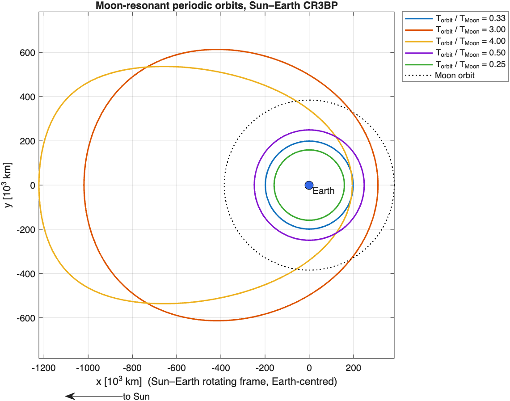
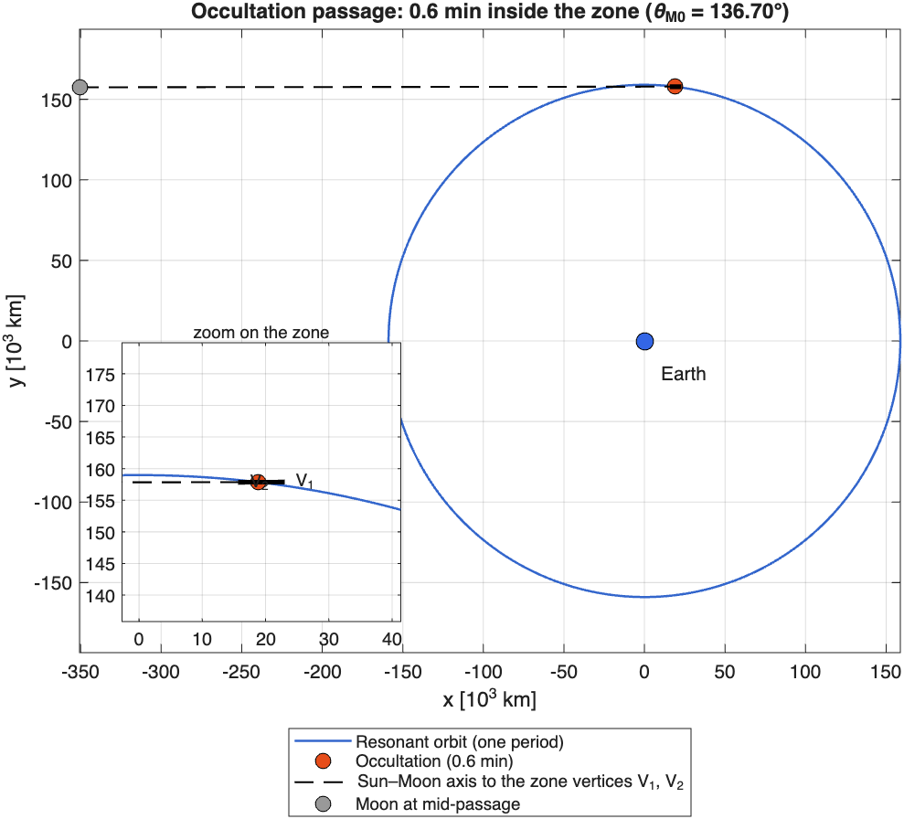
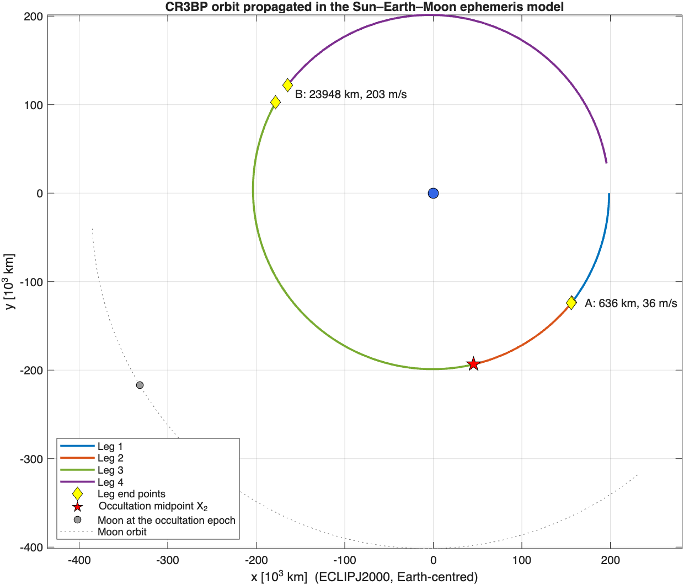

# MESOM
MESOM: Moon Enabled Sun Occultation Mission (https://www.ras.ac.uk/news-and-press/research-highlights/artificial-solar-eclipses-space-could-shed-light-sun) is a UK-led mission that aims to recreate solar eclipses in space in order to obtain high-quality observations of the solar corona by leveraging the Moon as a natural occulting body. It is a collaboration between leading space agencies and space engineering universities in the UK.
Code from an MSc thesis at the University of Surrey on the design of candidate trajectories for this mission in the Sun–Earth CR3BP. Main steps:
- Developing an accurate model of the Sun-Earth dynamical system, by implementing the governing CR3BP equations in MATLAB. The model was validated by consulting JPL's Periodic Orbit database.
- Modelling the evolution of the occultation zone caused by the Moon, by deriving the key geometrical constraints and propagating the orbit of the Moon around the Earth. For simplicity, the model has been initially based on the assumption of circular planar orbits, nevertheless a higher fidelity full-ephemeris model will later be implemented to obtain accurate results.
- Since for the purpose of this mission it is required for the candidate trajectories to be resonant with the Moon, numerical continuation techniques were employed to compute the initial conditions of moon-resonant periodic orbits.
- An event function was then written to detect which of the moon-resonant periodic orbits experienced passages in the occultation zone, for a range of initial Moon's positions which were iterated every 0.05° to find the most favourable orbits.

## Figures

Moon-resonant periodic orbits in the Sun–Earth CR3BP (initial conditions in `Periodic.csv`):

A passage through the lunar occultation zone, detected with `event_function.m` for one of the Moon initial phases found by the sweep in `Occultation_events.m`:

Both figures are produced by `make_figures.m`.

## Ephemeris model

`Ephemeris/` transfers the 3:1 Moon-resonant orbit (period of one third of the
synodic month) to a Sun–Earth–Moon point-mass model with SPICE ephemerides:

- `nbody_eom.m`: Earth-centred equations of motion with the Sun and the Moon
  as third bodies (direct and indirect terms), in ECLIPJ2000. Cross-checked
  against the N-body propagator of the University of Surrey astrodynamics
  course (not included): identical states after 9.8 days.
- `MAIN_patched_trajectory.m`: the orbit is no longer periodic in this model,
  so it is propagated in four legs from three CR3BP states (start,
  occultation midpoint, end of period) and the gaps at the two patch points
  are measured.

The second patch point is off by about 24,000 km and 200 m/s. The lunar
perturbation, absent from the Sun–Earth CR3BP, accumulates along the long
arc after the occultation.

SPICE kernels go in `Ephemeris/kernels/` (see the README there), and MICE
must be on the MATLAB path.
